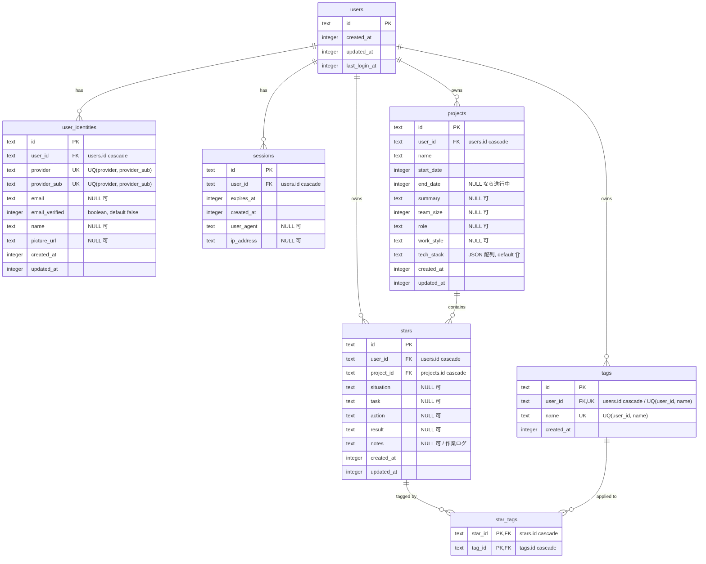

# データベース設計（ER 図）

StacX（Cloudflare D1 / SQLite）の全テーブルと関係。Drizzle スキーマ
（`packages/api/src/db/schema.ts`）が正典で、本図はその俯瞰用。
注記の無いカラムは NOT NULL。

図のソース（Mermaid）: [`docs/diagrams/er.mmd`](./diagrams/er.mmd)

## 補足（grill / ADR で確定した設計意図）

- **時刻はすべて epoch ミリ秒**（Drizzle `timestamp_ms`）。
- **表示情報の正典は `user_identities`**。`users` は ID と時刻のみ持つ（[ADR 0002](./adr/0002-user-table-id-only.md)）。
- **`projects.tech_stack` は JSON 配列**。絞り込み軸にしないため正規化しない（grill 決定）。表示専用。
- **`tags` は第一級エンティティ**で `(user_id, name)` 一意。STAR とは `star_tags` で多対多。STAR 一覧の絞り込み軸。
- **`stars` が記録の唯一の単位**（[ADR 0009](./adr/0009-star-as-the-only-unit.md)）。Project とのコンポジションで、生成時に 1 つの Project へ固定的に属し移動しない。`project_id` は `ON DELETE CASCADE` で、Project 削除時に STAR も連鎖削除される（[ADR 0005](./adr/0005-project-deletion-cascades-stars.md)）。
- **S/T/A/R は全カラム任意**。どの項目が埋まるかは決まっていないため列は NULL を許し、「少なくとも 1 項目」はリクエスト検証側で担保する。
- **状態の列は持たない**。完成 / 未解決の問題 / 解決中 / 背景未記入は 4 項目から導出する。経歴書出力の対象は完成した STAR だけ。
- **`notes` は作業ログ**。解決までの試行錯誤を残す自由記述 1 列で、経歴書には出さない。
- **`star_tags` の両 FK も cascade**。STAR 削除・Tag 削除のどちらでも中間行が掃除される。
- **削除の連鎖の頂点は `users`**。アカウント削除で配下（identities / sessions / projects / tags / stars / star_tags）がすべて消える。
- **`memos` / `star_logs` / `memo_tags` は移行中だけ残る**。Expand マイグレーション（0006）で `stars` / `star_tags` へ写し、production で移行結果を確かめてから Contract マイグレーションで消す（ADR 0009）。図には載せない。アプリからは読み書きしない。

> 注意: SQLite の `ON DELETE CASCADE` は FK 強制が有効な接続でのみ働く。D1 ランタイムでの実挙動は統合テストで検証する。
